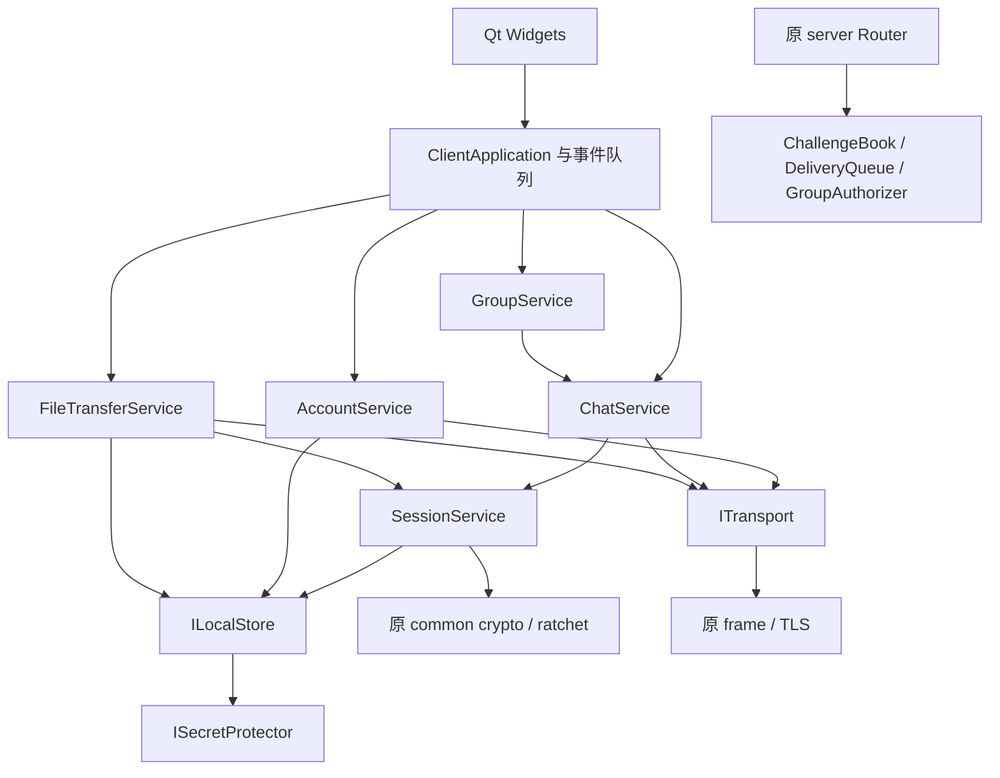

# 分层与代码边界

## 先确定工程事实

当前目录是 CipherChat；旁边的 cpp-defect-guard 仅提供纯 C++ Core/Qt 分层风格参考，本次没有修改它。用户提供的计划描述了目标，代码现状以本次读取与测试为准。

原来的 `client/core/client.cpp` 把身份、认证、棘轮、文件重传和事件回调放在同一个类中。正式桌面程序已切换为分层服务和 ClientApplication，旧 ClientCore 保留供 v1 回归。

## 依赖方向



服务器处理公钥、注册口令、认证材料和密文路由信息；注册口令在经过验证的 TLS 内发送。客户端 store 不能注入服务器，服务端头文件不依赖客户端身份/历史 DTO。Qt 通过业务 worker 的命令/事件队列使用 application，不承担 SQL、密钥或网络逻辑。

## 目录树

```text
cipherchat/
├── common/                   已有，继续保留一份算法与线协议
├── server/                   TLS、账号、密文队列、群成员授权
├── client/core/              已有单体客户端，回归与迁移来源
├── tests/                    原项目回归（50 cases）
└── framework/                正式客户端业务与验收框架
    ├── include/ccfw/
    │   ├── result.hpp        Result<T> / Error / NotImplemented
    │   ├── types.hpp         会话、明文、密文、历史、快照、进度 DTO
    │   ├── transport.hpp     ITransport / TlsTransport
    │   ├── local_store.hpp   ILocalStore / ISecretProtector
    │   ├── session_service.hpp
    │   ├── account_service.hpp
    │   ├── chat_service.hpp
    │   ├── file_transfer.hpp
    │   ├── group_service.hpp
    │   ├── server_services.hpp
    │   └── application.hpp   IEventSink / ClientEvent / ClientApplication
    ├── src/                  完整服务、快照与协议适配
    ├── gui/                  Qt 四页窗口、BusinessWorker 组合根
    ├── schema/               SQL 设计模板
    ├── tests/acceptance/     同名业务 CTest 与进程/GUI 测试驱动
    ├── tasks/                单任务输入与输出约束
    ├── scripts/              task.ps1 / verify.ps1
    └── docs/                 架构、接口契约与基线
```

## 现有复用点与禁止重复实现的部分

| 复用点 | 现有路径/符号 | 框架如何使用 |
|---|---|---|
| 字节与 Base64 | common/base64.hpp | 只在消息边界编码，Base64 不视为加密 |
| 加密原语 | common/crypto/crypto.hpp | 直接调用 randomBytes/x25519/ed25519/HKDF/AES-GCM |
| 公钥束 | common/ratchet/x3dh.hpp | 直接使用 X3dhPeerBundle，不造第二个束类型 |
| 棘轮 | common/ratchet/double_ratchet.hpp | 候选状态计算，验证和存储成功后提交 |
| 帧/JSON | common/protocol/frame.hpp、messages.hpp | 既有类型保留；新增协议通过版本协商 |
| 登录证明 | common/auth/login_proof.* | 双端复用公共公式，client 不链接 server |
| 文件块 | client/core/files.* | 修复短块校验后复用，不重写 GCM |
| 服务端 Peer | server/router/router.hpp | 保留可测试的投递边界 |
| SQLite 原存储 | server/storage/storage.* | 仅服务器用；可靠队列与群目录已接入 |

## 每个服务只做什么

- **AccountService**：身份装载、注册/登录阶段、口令证明与挑战处理。它不管理聊天历史。
- **SessionService**：对端信任、X3DH、候选 ratchet、明密文转换，以及与历史/去重/发件箱的一次原子提交。
- **ChatService**：发消息流程、待束队列、签收状态、重连重发。它不重新定义密码算法。
- **FileTransferService**：文件元数据加密入口、分块、ACK、进度、断点。文件密钥随快照受到保护。
- **GroupService**：维护群快照、逐成员调用 ChatService、汇总局部失败。
- **ClientApplication**：有限批次收包和消息分发，将结果发布为事件；不把所有逻辑重新堆回 tick。
- **ILocalStore**：完整客户端快照的加密与原子版本提交。课程设计优先简单可靠；历史量很大时另行拆表，保持接口事务语义。
- **TlsTransport**：连接/序列化/收包队列/关闭，只做传输。
- **服务端三个服务**：挑战单次消费、签收后删密文、群成员授权。

## 一次发送的固定顺序

1. ChatService 校验参数并创建逻辑消息 ID。
2. 尚无可信会话时请求束；用有界待发队列等待，出错返回可见失败。
3. SessionService 在快照副本上加密。
4. 一次事务保存新的 ratchet、history、outbox，revision 加一。
5. 提交成功后才调用 ITransport::send。
6. 断线保留原密文；重连 flushOutbox 重发同一个 ID/密文。
7. 收到经过认证的 recipient_ack 后推进签收状态并清理待发记录。

## 迁移规则

根 CMake 的 GUI 开关已接入 framework，目标 ccfw-desktop 输出 cipherchat.exe；两套构建使用同一源代码。正式入口只有一套 ClientApplication，不同时创建旧 ClientCore 处理同一连接。framework 可独立构建纯核心及桌面验收。

先复核/修复旧算法和边界，再适配新服务，最后接 GUI。若任务需要改公共接口，必须一起列出调用点和测试更新，禁止留下两个不兼容版本的同名协议。

## M10 当前组合关系（2026-10-11）

两套界面由主窗口复用一个 BusinessWorker、一个账号业务连接及同一会话状态。WorkspaceState 共享当前会话、固定项和草稿；两套界面分别保存布局比例与偏好。Qt 场景首次保留完整开场，隐藏时暂停动画与背景采样，热切换继续使用当前场景。

MessageStageEvent 解释真实业务步骤，不替换消息签收状态。视觉身份卡由共享 FeatureUi 显示公开身份材料，核对仍在业务线程复查当前公钥。DeliveryService 在业务线程中复用 FileTransferService，结构化 chat 和同库加密扩展表提供交付卡恢复、版本关联及人工确认。

用户要求删除的答辩启动器、本机演练服务、测试客户端和故障适配器已移除，不再构建或打包。旧端兼容验收所需的通用进程/JSON工具位于 tests/compatibility/process_io.hpp，仅供测试使用。独立更新器使用固定有界下载线程，它不拥有账号或会话。接口细节及兼容边界见 [M10 接口约定](features-contracts-20261007.md)，原演示版本证据保留为历史记录；当前变更与本地包见 [演示移除记录](../../docs/remove-demo-20261011.md)。
